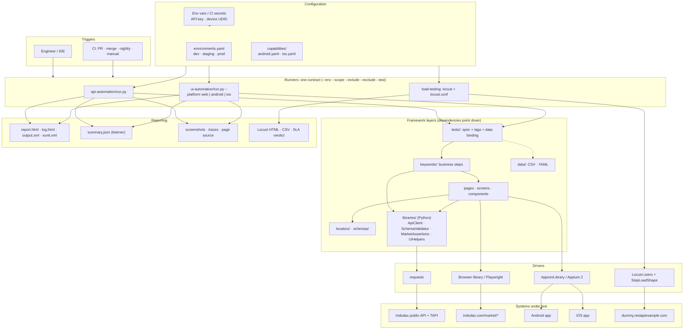
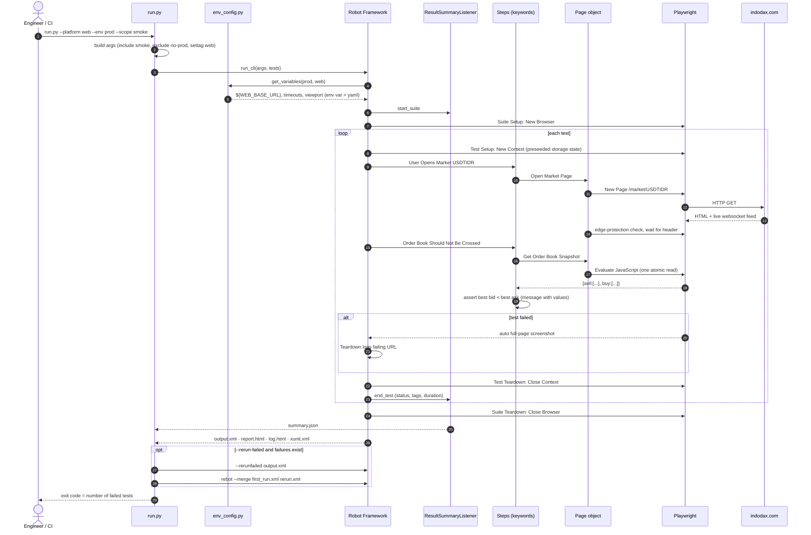
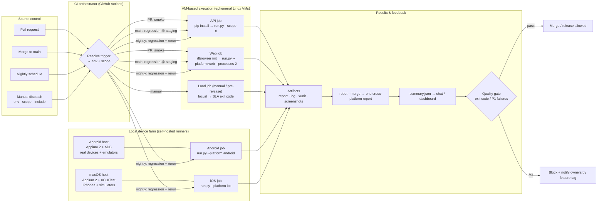

# Automation Architecture Design

Indodax QA Automation PoC: API, Web, Android and iOS functional automation, plus load testing.

| | |
|---|---|
| Scope | `api-automation/` · `ui-automation/` (web + mobile) · `load-testing/` |
| Stack | Python 3.11+ · Robot Framework 7 · Browser library (Playwright) · AppiumLibrary (Appium 2) · requests · jsonschema · DataDriver · pabot · Locust |
| Status | API verified (22 pass / 1 skip). Web verified partially, because of a Cloudflare block on the author's IP. Mobile dry-run only. Load verified. See [README](../README.md#verified-status-2026-11-23-windows-python-3152) |

Contents

1. [Architecture overview](#1-architecture-overview)
2. [Clean Architecture & Clean Code principles](#2-clean-architecture--clean-code-principles)
3. [Platform segregation: Web, API, Android, iOS](#3-platform-segregation-web-api-android-ios)
4. [Tagging strategy](#4-tagging-strategy-multi-tag-per-test-case)
5. [Environment strategy](#5-environment-strategy-dev--staging--prod)
6. [Test execution strategy](#6-test-execution-strategy)
7. [Error handling & reporting strategy](#7-error-handling--reporting-strategy)
8. [Diagrams](#8-diagrams): high-level architecture, sequence, CI/CD
9. [Extending the framework](#9-extending-the-framework)

---

## 1. Architecture overview

Three **independent projects** share **one set of conventions**:

| Project | Targets | Driver | Why separate |
|---|---|---|---|
| `api-automation/` | Indodax public API + private TAPI | `requests` (custom `ApiClient`) | Fastest feedback, no browser/device dependency, runs on any VM |
| `ui-automation/` | Web `indodax.com/market/*`, Android app, iOS app | Browser (Playwright), AppiumLibrary | UI tooling (Node, Playwright browsers, Appium) is heavy and must not slow down the API pipeline |
| `load-testing/` | `dummy.restapiexample.com` (≤ 10 RPS) | Locust | Different runtime model (users/RPS, not pass/fail per test) |

Each project owns its `requirements.txt`, `run.py` runner, `config/`, and `README.md`, so it can be
split into its own repository or pipeline without refactoring. They share:

- the same **layering** (tests → keywords → pages/screens/clients → locators/schemas → libraries → config/data),
- the same **runner contract** (`--env`, `--scope`, `--include`, `--exclude`, `--test`, `--rerun-failed`, `--dryrun`),
- the same **tag taxonomy** and **result layout** (`results/<platform>/<env>/<timestamp>/` + `summary.json`).

As a result, a QA engineer who knows one project can work in the others on day one.

---

## 2. Clean Architecture & Clean Code principles

### 2.1 Layering (dependency rule)

Dependencies point **inward only**. Outer layers know inner layers, never the reverse.

```
tests/                       WHAT is verified        – readable spec, tags, data binding only
  │
keywords/ (steps)            business language       – "User Opens Market", "Ticker Should Be Valid"
  │
pages/ screens/ components   HOW the UI is driven    – page/screen objects (UI only)
resources/*_common           infrastructure hooks    – sessions, setup/teardown, evidence capture
  │
locators/ schemas/           volatile details        – selectors, JSON contracts
libraries/ (Python)          technical capabilities  – HTTP client, signing, assertions, parsing, listeners
  │
config/  data/               environment & test data – no logic
```

| Rule | Where it is enforced | Benefit |
|---|---|---|
| Tests call **only** step keywords | `platforms/web/keywords/market_steps.resource`, `api-automation/keywords/*.resource` | A test reads like a specification. A UI redesign never touches `tests/` |
| Page objects expose **actions and getters only**. Assertions live in steps | `pages/market_page.resource` vs `keywords/market_steps.resource` | One page object serves many assertions. No hidden asserts |
| Selectors live **only** in `locators/*.py` | `platforms/web/locators/market_page.py`, `platforms/mobile/locators/{android,ios}/` | A selector change is a one-line fix |
| Complex logic goes in **Python**, not Robot | `libraries/ApiClient.py`, `SchemaValidator.py`, `MarketAssertions.py`, `UiHelpers.py` | Unit-testable, typed, debuggable in an IDE |
| Config and data **contain no logic** | `config/environments.yaml`, `data/*.csv`, `data/*.yaml` | Non-engineers can add test data. Environments can be diffed |

### 2.2 Clean Code rules

- **Single responsibility.** `ApiClient` only does transport (retry, HMAC signing, logging, masking). Schema validation is in `SchemaValidator`, and domain assertions are in `MarketAssertions`.
- **Intention-revealing names.** `Get …` returns data, `… Should …` asserts, `User …` acts. The keyword name tells the reader whether it can fail.
- **No magic values in tests.** URLs, timeouts and SLAs live in `config/`, selectors in `locators/`, inputs in `data/`.
- **Fail with context.** Every assertion message carries the actual value, for example `Crossed book on UI: best bid 18292 >= best ask 18291`, so `report.html` alone is enough for triage.
- **Correct numeric model.** Prices are compared with `Decimal`, because crypto amounts have 8 decimals and float rounding would create false failures.
- **Stable locator priority.** The order is stable id → domain data attribute (`tr[data-pair]`) → semantic class → text. Positional XPath, utility CSS classes and generated ids are never used.
- **Deterministic UI state.** One-time UI such as the "Personalisasi Tampilan Trade" modal is suppressed by a **preseeded storage state** (`isLiteMode`) in `Start Clean Context`, not handled per test. A `… If Shown` keyword remains as a logged safety net.
- **Atomic reads of live data.** Order-book checks read both sides in **one** in-page snapshot (`Get Order Book Snapshot`) instead of looping element handles over a DOM that re-renders every few hundred ms.

---

## 3. Platform segregation: Web, API, Android, iOS

```
api-automation/                                  ─► API
ui-automation/
├── platforms/web/       pages · components · locators · keywords · tests   ─► Web (Playwright)
└── platforms/mobile/    screens · keywords · tests                          ─► Android + iOS (Appium)
        locators/android/market_screens.py  ┐  SAME variable names,
        locators/ios/market_screens.py      ┘  DIFFERENT values
config/capabilities/android.yaml · ios.yaml      ─► device capabilities per platform
```

| Decision | Rationale |
|---|---|
| **API is its own project** | No UI dependencies. It runs in seconds on any VM, and it is the quality gate for every PR |
| **Web and mobile never share page/screen objects** | The UX differs (DOM tables vs native lists, hover vs tap). Sharing would force `IF platform` branches everywhere |
| **Android and iOS share screens, steps and tests** | Same business flows. Only **locator values** and **capabilities** differ, so the platform is a runtime parameter |
| **Platform selected at runtime** | `run.py --platform ios` → `env_config.py:<env>:ios` injects `${CAPABILITIES}` and `${SCREEN_LOCATORS}`. Tests contain no platform conditionals |
| **Shared cross-platform pieces** | `libraries/UiHelpers.py` (number parsing, tolerance asserts, storage state), `ResultSummaryListener`, runner conventions |
| **Every result is platform-tagged** | `--settag web\|android\|ios` (UI) and `api` (suite tag) mean results from all four platforms merge into one report: `rebot --merge */output.xml` |

A platform-specific flow (for example iOS Face ID) becomes a new **screen keyword** in the iOS
locator/screen layer. A test never branches on platform.

---

## 4. Tagging strategy (multi-tag per test case)

Every test carries **one tag from each dimension**:

| Dimension | Tags | Used for |
|---|---|---|
| Platform | `api` `web` `android` `ios` (+ `ui`, `mobile`) | Routing a job to the right runner (VM vs device farm) |
| Level | `smoke` `regression` | Execution scope per trigger |
| Feature | `pairs` `ticker` `orderbook` `trades` `summaries` `auth` · `market` `search` `orderbook-ui` `trade-history` `navigation` | Selective runs by area or code owner |
| Type | `positive` `negative` `contract` `consistency` | Coverage reporting ("do we have negative tests for X?") |
| Priority | `P1` `P2` `P3` | Triage order. `--exclude P3` for quick runs. P1 failures highlighted in `summary.json` |
| Guards | `no-prod` `requires-credentials` | Safety. `no-prod` is excluded automatically on prod. `requires-credentials` skips with a reason if secrets are absent |

Example: `api ticker smoke regression positive contract P1`.

**Tags come from three places**, merged by Robot Framework:

1. `Test Tags` in the suite file → feature and type (shared by every test in that file)
2. `[Tags]` on the test, or the `[Tags]` column of a DataDriver CSV row → level and priority
3. `--settag` from `run.py` → platform

**Selective-run examples**

```powershell
python run.py --scope all --include ticker --include orderbook   # union of two features
python run.py --scope regression --exclude P3                    # skip low priority
python run.py --test "*Crossed*"                                 # by test name
robot --include "smokeANDP1" ...                                 # boolean tag expression
```

Rules: tags are lower-case kebab-case, except priority (`P1`). A new feature adds **one** tag to the
feature dimension and is documented here. Priority tags are excluded from tag statistics
(`--tagstatexclude P?`) to keep the report readable.

---

## 5. Environment strategy (dev / staging / prod)

### 5.1 Resolution order

```
environment variable   >   environments.yaml[env]   >   environments.yaml[common]
   (CI secret store,          (per-environment             (shared defaults:
    one-off overrides)          URLs, retries, SLA)          browser, viewport, timeouts)
```

`config/env_config.py` is a Robot Framework **variable file**. It merges the three sources, keeps types
(bool, int, str), and exposes everything as `${UPPER_CASE}` variables. For mobile it also loads
`config/capabilities/<platform>.yaml` and expands `${ANDROID_UDID}`-style placeholders from the
environment, so the same file works on a laptop emulator and on any device in the farm.

### 5.2 Environment matrix

| | dev | staging | prod |
|---|---|---|---|
| API base URL | `http://localhost:8080` (mock) | `https://staging.indodax.example` (placeholder) | `https://indodax.com` |
| Web base URL | `http://localhost:3000` | placeholder | `https://indodax.com` |
| Retries (429/5xx) | 0, so flakiness surfaces | 1 | 2, with exponential backoff |
| Timeout | 5 s | 10 s | 10 s |
| `read_only` | false | false | **true** |

Indodax does not publish public dev or staging hosts. Those entries demonstrate the mechanism, and can be
overridden at runtime: `API_BASE_URL=https://… python run.py --env staging`.

### 5.3 Safety rules

- **Secrets never live in files.** `INDODAX_API_KEY`, `INDODAX_API_SECRET` and device UDIDs come only from the process environment or the CI secret store. HTTP logs mask the `Key` and `Sign` headers.
- **Prod is read-only by construction.** `run.py` always appends `--exclude no-prod` for `--env prod`. There is no CLI flag to disable it.
- **Credential-gated tests skip, not fail.** `requires-credentials` tests call `Skip If` with an explicit reason, so a missing secret is visible in the report but does not break the pipeline.
- **Stable UI state per environment.** Each browser context gets the same preseeded storage state, so environments behave the same regardless of first-visit popups.

---

## 6. Test execution strategy

### 6.1 Triggers and scope

| Trigger | Scope | Platforms | Command | Time budget |
|---|---|---|---|---|
| Pull request | `smoke` | API + Web | `run.py --scope smoke` | < 3 min |
| Merge to `main` | `regression` on staging | API + Web | `run.py --env staging --scope regression` | < 15 min |
| Nightly | full `regression` + `--rerun-failed` | API + Web + Android + iOS | per platform, device jobs on the local farm | < 60 min |
| Pre-release | regression + load profile | all + Locust | `locust` (step profile 2→5→8→10 RPS) | — |
| Ad hoc / bug fix | selective | any | `--include orderbook` / `--test "*Crossed*"` | — |

### 6.2 Data-driven design

- **DataDriver** turns each CSV row into its own test, with its own name, tags and pass/fail. Adding a market is a one-line change in `data/*.csv`.
- **`[Template]`** covers small inline matrices (for example the invalid-pair cases).
- **YAML catalogues** (`data/pair_catalog.yaml`) hold expected static attributes, kept apart from the tests.

### 6.3 Isolation and stability

| Concern | Approach |
|---|---|
| Test isolation (web) | One browser per suite. A **fresh context per test** (cookies and storage), with a preseeded known state |
| Test isolation (mobile) | App restarted per test. `noReset: true` keeps onboarding done for speed |
| Waiting | Playwright auto-wait and assertion-retry (`Get Text … matches`). No `Sleep` |
| Live data | Atomic snapshots, tolerance-based price checks (1 %), invariants instead of exact values |
| Retries | **Transport only** (429/5xx/timeouts in `ApiClient`), never on assertions |
| Rerun | `--rerun-failed`: failed tests run once more and the results are **merged** with `rebot`, so flakiness stays visible |
| Parallelism | `run.py --processes N` (pabot) for UI suites. API is fast enough serially |
| Load | `constant_throughput` pacing + `StepLoadShape`, with a listener that aborts the run if RPS exceeds 10 |

---

## 7. Error handling & reporting strategy

### 7.1 Error handling by layer

| Layer | Mechanism | Outcome |
|---|---|---|
| Transport (API) | `ApiClient` retries `ConnectionError`/`Timeout`/429/502/503/504 with exponential backoff, then raises `ApiClientError(method, url, status, body excerpt)` | Network noise does not fail tests. Real outages fail with full context |
| Parsing | `Get Json Body` fails with the raw text when a body is not JSON (for example an HTML 429 page) | No cryptic `JSONDecodeError` |
| Contract | `Json Should Match Schema` reports **all** violations with JSON paths | One run shows every contract break |
| Business errors | Indodax returns HTTP 200 with an error envelope for invalid pairs. Negative tests assert the envelope, not the status | Correct oracle for this API |
| Web environment | `Fail If Blocked By Edge Protection` detects a Cloudflare or WAF page and fails with `ENVIRONMENT BLOCK, not a product defect` | Triage does not chase a fake locator timeout |
| Web evidence | `run_on_failure` full-page screenshot, failing URL logged, optional Playwright trace (`--trace`) | Reproducible failures |
| Mobile session | `Open Mobile Session` raises `Fatal Error` with the root cause if Appium or the device is unreachable | One clear error instead of 50 identical failures |
| Mobile evidence | Automatic screenshot + page-source XML dump on failure | Locator debugging without a re-run |
| Optional UI | `Tap If Present`, `Dismiss … If Shown` (logged as WARN when triggered) | Promos and dialogs never fail a test, but are still visible |
| Load | Stable failure names (`HTTP 429 rate limited`) for aggregation. RPS guard aborts at > 10 RPS | Clean failure tables, and the load limit is respected |

### 7.2 Reporting

| Artifact | Producer | Consumer |
|---|---|---|
| `report.html` / `log.html` | Robot Framework | Engineers. Request and response bodies are collapsible, truncated at 2 KB, with secrets masked |
| `output.xml` | Robot Framework | `rebot --merge` across platforms and reruns |
| `xunit.xml` | Robot Framework | CI test tab |
| `summary.json` | `ResultSummaryListener` | Chat-ops and dashboards. Totals, pass rate, **P1 failures**, per-feature breakdown, slowest tests, every failure with its tags |
| Screenshots, traces, page source | Browser and AppiumLibrary hooks | Failure triage |
| `report.html`, CSV, `summary.md`/`summary.json` | Locust + listeners | SLA verdict, per-endpoint status distribution, per-load-level percentiles, automated interpretation |

Result layout: `results/<platform>/<env>/<timestamp>/` plus `results/latest/`. Environment, scope and
platform are stamped into the report metadata.

**Exit codes drive the pipeline.** Robot returns the number of failed tests. Locust returns 0 on pass,
1 on an SLA breach and 2 when the RPS guard fires.

---

## 8. Diagrams

### 8.1 High-level architecture



### 8.2 Sequence diagram (surface view)

A web smoke test from trigger to report. API and mobile follow the same shape, with `ApiClient` or
Appium in place of Playwright.



### 8.3 CI/CD pipeline

- **Web & API → VM-based execution.** Ephemeral Linux VMs (GitHub-hosted or self-hosted VM runners). Stateless, horizontally scalable, cheap.
- **Mobile → local device farm.** A self-hosted runner on a lab host with real devices and emulators attached. Android runs on a Linux/Windows host via ADB. iOS needs a macOS host with Xcode. Appium 2 runs on that host and jobs are routed by runner labels.



| Aspect | VM (Web & API) | Device farm (Mobile) |
|---|---|---|
| Runner | `runs-on: ubuntu-latest` or a self-hosted VM label | `runs-on: [self-hosted, android]` / `[self-hosted, macos, ios]` |
| Provisioning | `pip install` + `rfbrowser init chromium` per job (pip cache) | Pre-provisioned: Appium 2, drivers, SDKs, signed builds |
| Concurrency | Many VMs in parallel, plus `--processes` within a job | Limited by devices. One job per device, with UDID from runner env |
| Secrets | CI secret store → env vars | Device UDIDs/app paths in runner env. API secrets from CI store |
| Trigger | Every PR (smoke), main, nightly | Nightly and pre-release (devices are scarce) |
| Failure mode | Stateless VM, so a retry is a clean slate | `Fatal Error` if Appium or a device is down, so the farm problem is reported as infra, not as test failures |

Current state of `.github/workflows/automation.yml`: the API, Web and Load jobs are implemented on
GitHub-hosted VMs. The Android and iOS jobs are documented as commented placeholders, because no
device farm runner is registered yet. Adding them only means registering self-hosted runners with the
labels above and adding two jobs that call `run.py --platform android|ios`.

---

## 9. Extending the framework

| Change | Where | Touches tests? |
|---|---|---|
| New market to cover | one row in `data/*.csv` | No |
| Selector changed by a redesign | `locators/*.py` | No |
| New API endpoint | `keywords/<feature>.resource` + `resources/schemas/<x>.json` + new suite in `tests/` | New suite only |
| New page | `pages/<page>.resource` + `locators/<page>.py` + steps | New suite only |
| New environment | one block in `environments.yaml` | No |
| New platform (for example a tablet layout) | new locator file + capabilities file + `PLATFORMS` entry in `env_config.py` | No |
| New report consumer | read `summary.json` | No |
